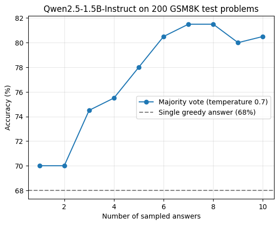
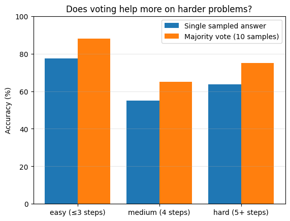

# Majority Voting on GSM8K with a Small Model

**Question:** Does majority voting over sampled answers (self-consistency) improve a small language model's math accuracy, and where does it stop helping?

**Short answer:** Yes. On 200 GSM8K test problems, Qwen2.5-1.5B-Instruct goes from **68.0%** with one greedy answer to **80.5%** with a majority vote over 10 samples. The correct answer appears somewhere in the 10 samples **93.5%** of the time, so better answer selection could go further.

| Method | Accuracy (200 problems) |
| --- | --- |
| Single greedy answer | 68.0% (136/200) |
| Single sampled answer (temperature 0.7) | 70.0% (140/200) |
| Majority vote over 10 samples | 80.5% (161/200) |
| Correct answer among the 10 samples (pass@10) | 93.5% (187/200) |

## Setup

- **Model:** [Qwen2.5-1.5B-Instruct](https://huggingface.co/Qwen/Qwen2.5-1.5B-Instruct), float16, on a free Google Colab T4 GPU
- **Data:** the first 200 problems of the [GSM8K](https://huggingface.co/datasets/openai/gsm8k) test split (grade-school math word problems that need multi-step reasoning)
- **Prompt:** the question, followed by "Solve step by step, then end with: Answer: \<number\>" (chain-of-thought prompting)
- **Greedy baseline:** one answer per problem, `do_sample=False`, up to 512 new tokens
- **Sampling:** 10 answers per problem, temperature 0.7, top_p 0.95, up to 512 new tokens
- **Answer extraction:** the number after "Answer:", falling back to the last number in the reply; compared numerically with GSM8K's gold answer
- **Voting:** the most common extracted answer among the samples

## Results

### Accuracy vs. number of samples

| Samples (k) | 1 | 2 | 3 | 4 | 5 | 6 | 7 | 8 | 9 | 10 |
| --- | --- | --- | --- | --- | --- | --- | --- | --- | --- | --- |
| Accuracy (%) | 70.0 | 70.0 | 74.5 | 75.5 | 78.0 | 80.5 | 81.5 | 81.5 | 80.0 | 80.5 |

Voting works, with diminishing returns: accuracy rises quickly up to about 6 samples, then levels off around 80–81.5%. (k=2 always equals k=1, because a 1–1 tie goes to the first sample. The small dip at k=9 is within noise.)

### Does voting help more on harder problems?

I used the number of steps in GSM8K's reference solution as a rough difficulty measure. The comparison here is a single sampled answer vs. a majority vote over 10 samples.

| Difficulty | Problems | Single sample | Majority vote | Gain |
| --- | --- | --- | --- | --- |
| Easy (≤3 steps) | 116 | 77.6% | 87.9% | +10.3 |
| Medium (4 steps) | 40 | 55.0% | 65.0% | +10.0 |
| Hard (5+ steps) | 44 | 63.6% | 75.0% | +11.4 |

Voting helped about equally at every difficulty level (about +10 points each). Medium problems scoring lower than hard ones is likely noise (each medium problem is worth 2.5 points), or a sign that solution length is an imperfect difficulty measure.

### Where do the remaining errors come from?

- Compared with a single sampled answer, voting **fixed 24 problems and broke 3**.
- Of the **39 problems still wrong** after voting, only **3** had 7 or more of 10 samples agreeing on the same wrong answer. Most remaining errors come from the model being **uncertain** (its samples disagree), not consistently wrong.
- In **26 problems**, the correct answer appeared among the 10 samples but lost the vote. A perfect selector could raise accuracy from 80.5% to 93.5% without any extra sampling.

### Error examples from a 10-problem pilot

Before scaling up, I checked every wrong answer by hand (5/10 correct with greedy decoding). All five errors were misreadings of the problem, not arithmetic slips:

- Treated a 150% increase in a house's value as the final sale price
- Treated "3 times a week" as 3 times every day
- Read "every second glass is discounted" as every glass after the first
- Placed a download restart at 50% instead of 40%
- Treated 2 hours stuck in traffic as driving at 30 mph

## Findings

1. Majority voting raised accuracy by 12.5 points over greedy decoding, with most of the gain in the first 6 samples.
2. The gain was about the same across difficulty levels.
3. Most remaining errors are uncertain rather than confident: the model's samples disagree.
4. The right answer is often generated but not selected (93.5% pass@10 vs. 80.5% voting), which suggests a verifier could help.

## Limitations

- Only 200 problems, so each problem is worth 0.5 points; differences of 1–2 points are within noise
- One model, one temperature, one prompt
- Solution length is only a rough measure of difficulty
- The difficulty and error comparisons use a single sampled answer, not the greedy answer

## Next step

Train or use a **verifier** to pick the best answer from the samples, and compare it with majority voting at the same compute (following Cobbe et al., 2021).

## References

1. Wang et al. (2022). [Self-Consistency Improves Chain of Thought Reasoning in Language Models](https://arxiv.org/abs/2203.11171)
2. Wu, Sun, Li, Welleck, Yang (2024). [Inference Scaling Laws: An Empirical Analysis of Compute-Optimal Inference for Problem-Solving with Language Models](https://arxiv.org/abs/2408.00724)
3. Cobbe et al. (2021). [Training Verifiers to Solve Math Word Problems](https://arxiv.org/abs/2110.14168)
